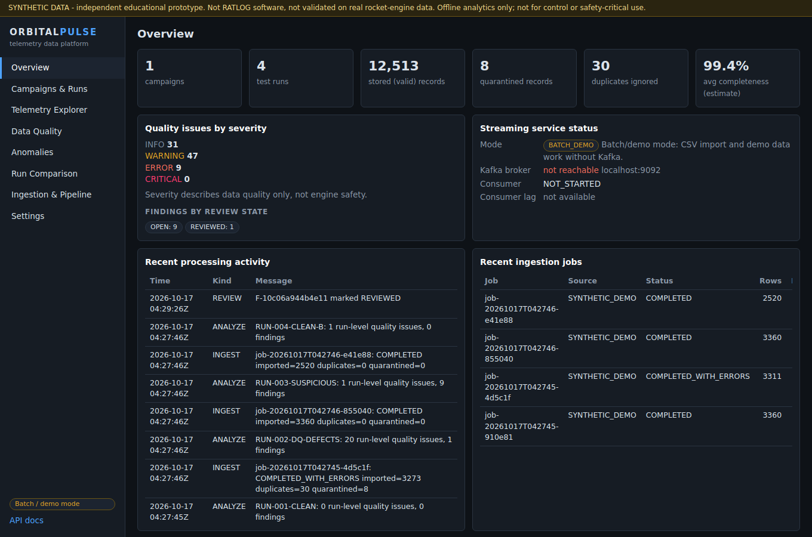
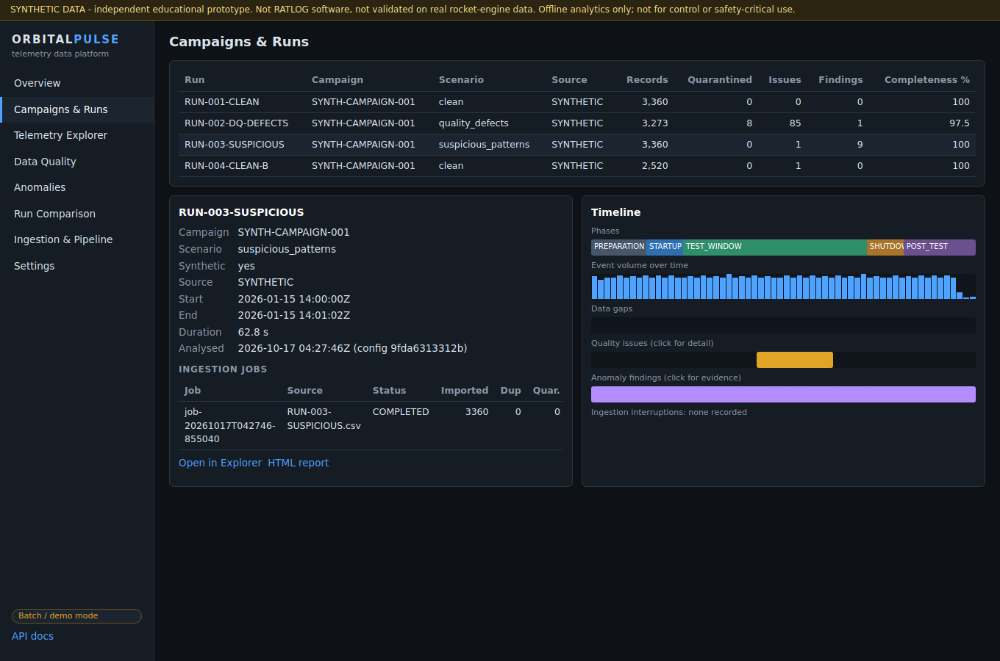
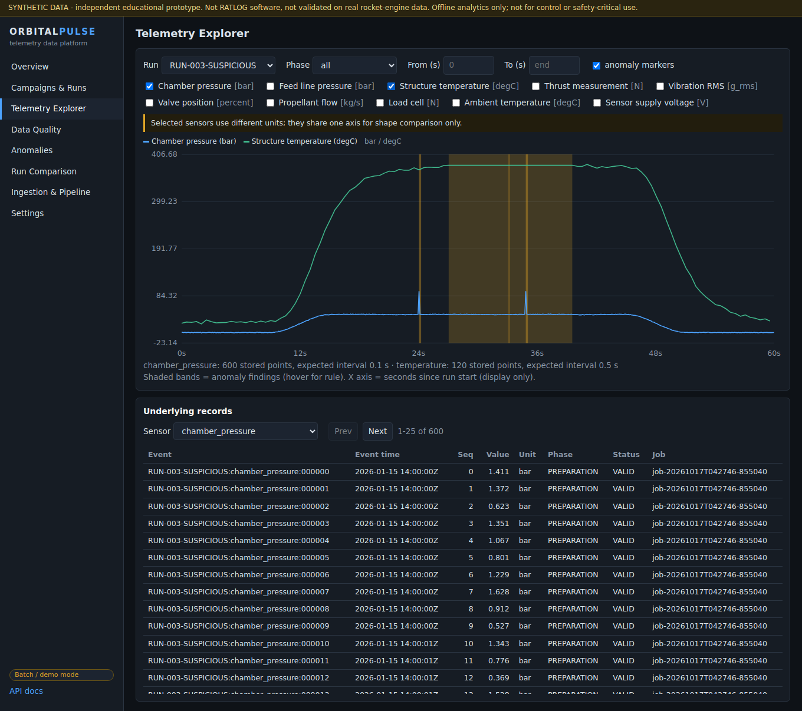
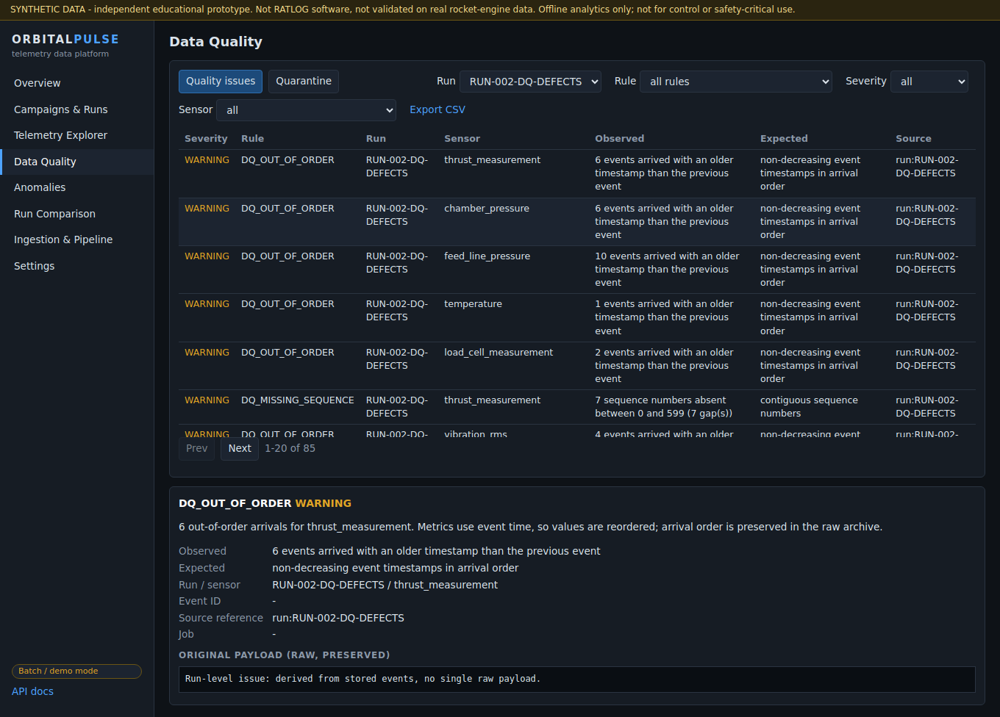
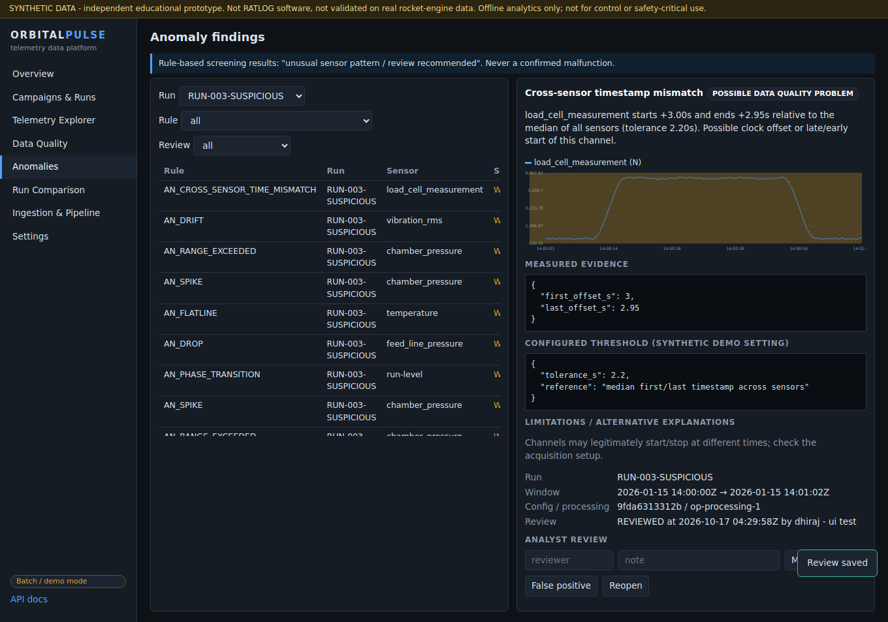
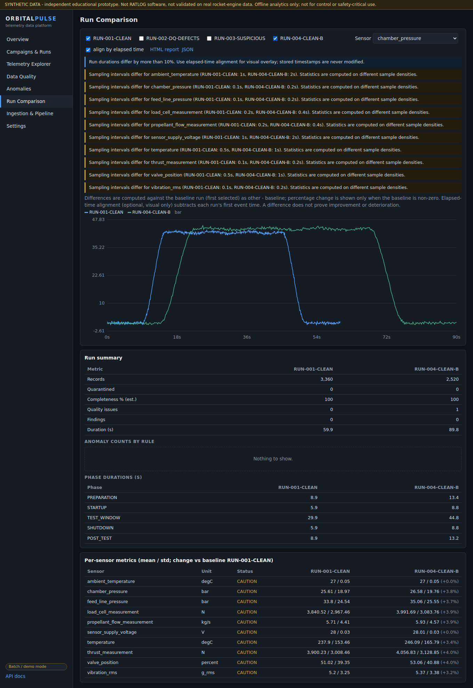
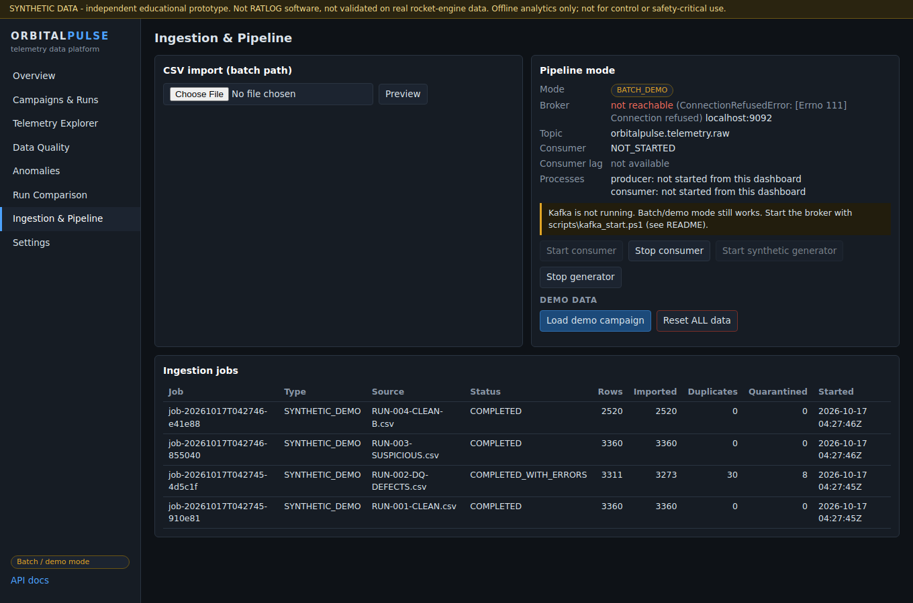
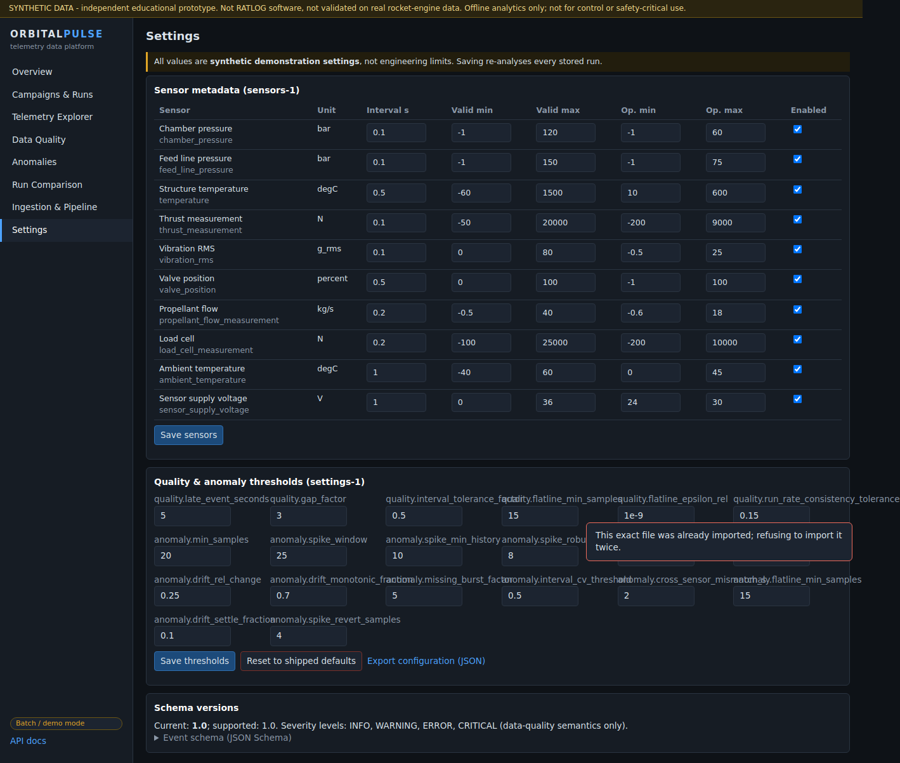

# OrbitalPulse - Rocket Test Data Pipeline and Telemetry Intelligence Platform

> **SYNTHETIC DATA. Independent educational prototype.** Not RATLOG software, not endorsed by RATLOG, not validated with real rocket-engine test data. Thresholds are demonstration settings, not engineering limits. Offline analytics only - not for engine control, launch authorization, or safety-critical monitoring.

A streaming-first telemetry data platform that ingests simulated ground-test data (CSV or Kafka), validates every record, preserves raw evidence, quarantines bad data, flags suspicious patterns with explainable rules, compares runs, and produces reports.

## Features
| Feature | Status |
|---|---|
| Deterministic synthetic generator (4 demo runs, 10 sensors, injected defects) | Implemented |
| Canonical versioned event schema + validation, missing-vs-zero handling | Implemented |
| CSV ingestion (preview, column mapping, size/format checks, duplicate-file refusal) | Implemented |
| Raw append-only archive, SQLite store, lineage (job, source_ref, config/processing version) | Implemented |
| Quarantine store (filter, inspect payload, export, replay for unknown-sensor) | Implemented (replay: API only) |
| Quality rules (16+), anomaly rules (9 + insufficient-evidence), analyst review | Implemented |
| Run comparison (units/rate warnings, elapsed alignment, deltas) | Implemented |
| Timeline per run (phases, volume, gaps, issues, findings) | Implemented |
| Reports: JSON, CSV, HTML with computed executive summary | Implemented (PDF not implemented) |
| REST API + OpenAPI (`/docs`), honest readiness/status | Implemented |
| Dashboard (8 pages, real API calls) | Implemented |
| Kafka producer/consumer, at-least-once + idempotent storage, lag, graceful fallback | Implemented, verified on Linux with Kafka 4.1.2 |
| Dashboard start/stop of Kafka producer/consumer | Partial |
| Docker Compose, dbt, GitHub Actions, data-quality score, Parquet, auth | Planned / not implemented |

## Screenshots (captured from the running app, synthetic data)









## Architecture
See [docs/ARCHITECTURE.md](docs/ARCHITECTURE.md) (Mermaid diagram, storage, delivery semantics, anomaly design). Also: [DATA_DICTIONARY](docs/DATA_DICTIONARY.md), [RUNBOOK](docs/RUNBOOK.md), [DEMO_SCRIPT](docs/DEMO_SCRIPT.md), [ENGINEERING_DECISIONS](docs/ENGINEERING_DECISIONS.md), [IMPLEMENTATION_CHECKLIST](docs/IMPLEMENTATION_CHECKLIST.md).

Stack: Python, FastAPI, pydantic, SQLite, kafka-python (Kafka 4.1.2 KRaft), vanilla JS + SVG, pytest, ruff, mypy.

## Prerequisites (Windows)
Python 3.11+ (3.12/3.13 is the safest choice; development was verified on 3.12), PowerShell. For Kafka mode: Java 17+ (JDK 21 is fine) and the Kafka folder (`.\kafka_2.13-4.1.2` or `C:\k\kafka` or `$env:KAFKA_HOME`). No Docker, API keys, or cloud account needed.

## Install and run (PowerShell, project root)
```powershell
.\scripts\setup.ps1          # creates .venv, installs requirements-dev.txt
.\scripts\run_demo.ps1       # generates + imports demo data, starts http://127.0.0.1:8000
```
Equivalent manual commands:
```powershell
python -m venv .venv
.\.venv\Scripts\python -m pip install -r requirements-dev.txt
.\.venv\Scripts\python scripts\op.py generate-demo    # sample-data generation (deterministic CSVs in data\demo)
.\.venv\Scripts\python scripts\op.py import-demo      # import them (use --reset to wipe first)
.\.venv\Scripts\python scripts\op.py serve
```
Reset demo data: `.\scripts\reset_demo.ps1`.

## Demo workflow
Follow [docs/DEMO_SCRIPT.md](docs/DEMO_SCRIPT.md): clean run, defect run (quarantine + payloads), anomaly evidence + review, run comparison, HTML report.

## Kafka workflow
```powershell
.\scripts\kafka_start.ps1      # terminal 1: broker (keep open)
.\scripts\run_demo.ps1         # terminal 2: dashboard
.\scripts\kafka_demo.ps1       # terminal 3: consumer + producer (2% duplicate redelivery)
```
Direct commands: `python -m orbitalpulse.ingestion.kafka_producer --runs RUN-002-DQ-DEFECTS --rate 500` and `python -m orbitalpulse.streaming.kafka_consumer`. Without a broker the apps say so and exit with code 2; the dashboard stays in "Batch / demo mode".

## Tests
```powershell
.\scripts\test.ps1             # = python -m pytest -rs ; ruff check orbitalpulse tests scripts
```
Last verified run (Linux sandbox, Python 3.12, Kafka 4.1.2 broker running): **80 passed, 0 skipped**; `ruff`: clean; `mypy orbitalpulse`: no issues. Kafka tests skip with an explicit reason when no broker is reachable. Legacy C-MAPSS tests (`legacy_cmapss/`) still pass (8 + 3 script checks).

## What this prototype proves
- A telemetry pipeline can be built with lineage, raw-data preservation, explicit quality states, and no silent data loss.
- Idempotent storage makes at-least-once Kafka delivery safe (a full-topic replay by a fresh consumer group added 0 rows).
- Explainable, configurable rules can separate invalid data, unusual-but-valid data, and missing evidence.
- Deterministic generation and reports make results reproducible.

## What this prototype does not prove
No real rocket-test data was used; no propulsion limits are validated; findings are screening results, not diagnoses; nothing here supports flight certification, engine control, shutdown logic, or safety-critical monitoring. Performance at scale is not benchmarked.

## Limitations and honest caveats
- **Windows scripts (`*.ps1`) and Python 3.14 were not run by me** - development/testing happened on Linux (Python 3.12); the Python code is cross-platform and paths are relative, but expect to fix small Windows issues. `kafka_start.ps1` is the least-verified piece.
- SQLite, full-run re-analysis and unauthenticated local API: suited to laptop-scale demos, not production. CORS is limited to localhost origins (`ORBITALPULSE_CORS_ORIGINS`).
- Completeness/missing-rate are estimates unless sequence numbers exist. `CRITICAL` severity is defined but no rule emits it.
- Charts have no zoom/pan; the dashboard was exercised with headless Chrome (Playwright), not across browsers.
- `.env.example` is omitted because no environment variables are required (optional: `ORBITALPULSE_DATA_DIR`, `ORBITALPULSE_CORS_ORIGINS`).

## Roadmap
Migration framework, data-quality score, Parquet export, GitHub Actions CI, Docker Compose, PDF reports, chart zoom, auth, consumer-lag history.

## Legacy work
Your earlier NASA C-MAPSS turbofan pipeline is preserved in [`legacy_cmapss/`](legacy_cmapss/README_cmapss.md) (code, tests, outputs, backups).
