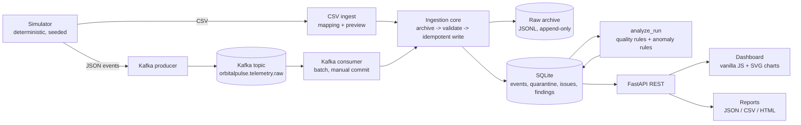

# Architecture

OrbitalPulse is an **offline telemetry analytics platform for synthetic data**. It is not a control or safety system.

## Components (`orbitalpulse/`)
| Module | Responsibility |
|---|---|
| `config.py`, `config/*.json` | Sensor metadata and thresholds (pydantic-validated). User edits are saved as overrides in `data/config/`, shipped defaults stay untouched. A config fingerprint is stored on every analysis. |
| `schemas/` | Canonical event model (schema 1.0) and `validate_event`, which never raises: it returns an event, a rejection (rule id, observed, expected, explanation) and warnings. |
| `simulator/` | Seeded generator; 4 demo runs (clean, quality defects, suspicious patterns, clean-B with different rate/duration/gain). |
| `ingestion/` | `core.py` (shared by all paths), `csv_ingest.py`, `kafka_producer.py`. |
| `streaming/` | `kafka_consumer.py`, `status.py` (real TCP reachability, consumer heartbeat, lag). |
| `storage/` | `db.py` (schema + connections), `archive.py` (raw JSONL). |
| `quality/rules.py` | Run-level data-quality rules. Event-level rules live in `schemas/validation.py` and `ingestion/core.py`. |
| `analytics/` | `metrics.py`, `anomalies.py`, `compare.py`, `timeseries.py`. |
| `pipeline.py` | `analyze_run`: deterministic recomputation of run-level issues and findings. |
| `reporting/` | Deterministic JSON/CSV/HTML reports with executive summary generated from computed values. |
| `api/` | FastAPI app (+ optional child-process manager for producer/consumer). |
| `frontend/` | Static dashboard served by the API. No build step. |

## Data flow and lineage
1. Every incoming payload is written to the **raw archive first** (`data/raw/<job_id>.jsonl`, with its `source_ref`: `file.csv:LINE` or `kafka:topic:partition:offset`).
2. `validate_event` classifies it: **stored** (VALID / MISSING value), or **quarantined** with the original payload.
3. Stored events carry `job_id`, `processing_version`; findings carry `config_version` + `processing_version`; quality issues carry `source_ref`, so any result traces back to a raw payload.
4. `analyze_run` recomputes run-level issues and findings from stored events.

## Storage design
SQLite (WAL). Tables: `ingestion_jobs`, `campaigns`, `runs`, `events` (unique `event_id`), `quarantine` (unique `dedupe_key`), `quality_issues`, `findings`, `service_status`, `activity`, `schema_meta`. Schema is created idempotently by `init_schema`; `schema_meta.db_schema_version` is reserved for future migrations (none exist yet). Raw archive files are never rewritten.

## Idempotency and delivery semantics
- `events.event_id` is unique and writes use `INSERT OR IGNORE`. Same id + identical payload = **duplicate delivery** (counted, INFO issue, first copy kept). Same id + different payload = **conflict**, quarantined; the original is never overwritten.
- Quarantine writes are deduplicated by (source_ref, rule, payload), so replaying the same message does not inflate quarantine.
- Kafka: **at-least-once delivery with idempotent storage**. Per batch: write SQLite, `COMMIT`, then commit Kafka offsets. A crash in between replays the batch; the stored result is unchanged. On a processing error the batch is rolled back, offsets are not committed, the consumer seeks back and retries. **Exactly-once is not claimed.**
- Partition key `test_run_id|sensor_id`: preserves per-sensor ordering (needed by sequence/gap/interval rules) while spreading sensors over partitions. Cross-sensor order is not guaranteed, so cross-sensor rules use event timestamps, never arrival order.
- Topics: only `orbitalpulse.telemetry.raw` is used. Invalid messages are quarantined in SQLite (queryable) rather than republished to a second topic; this is a deliberate simplification.

## Failure handling
Malformed rows/messages are quarantined, never fatal. Failed CSV imports are recorded as `FAILED` jobs and can be retried (identical *completed* files are refused with HTTP 409). Missing Kafka is reported by `/api/status` (real socket check); batch/demo mode keeps working. Unhandled API errors return a generic 500 (details only in the server log).

## Anomaly detection design
Rule-based, robust statistics (rolling median/MAD), no ML/LLM. Each finding stores rule, window, measured evidence, threshold, plain-English explanation generated from those numbers, and limitations. Categories: THRESHOLD_EXCEEDED, UNUSUAL_SENSOR_PATTERN, POSSIBLE_DATA_QUALITY_PROBLEM, INSUFFICIENT_EVIDENCE. Notable choices:
- Spikes/drops must **revert** to baseline within a few samples; ramps and level shifts are not spikes.
- Drift looks only at the labelled TEST_WINDOW (first 10% excluded as settling).
- If every sensor in a run deviates from its configured interval by a similar factor, it is reported once as `DQ_RUN_SAMPLE_RATE_DIFFERS` (INFO) and completeness is estimated against the observed cadence.
- Too few samples gives `AN_INSUFFICIENT_DATA` (missing evidence), never a diagnosis. No "confidence" number is produced because none has a defined meaning.
- Findings have deterministic ids (run, rule, sensor, window). Analyst review state is preserved across re-analysis as long as the finding still exists; if changed data/thresholds remove a finding, its review record goes with it.

## Trade-offs
SQLite and full-run recomputation keep things simple and reproducible but will not scale to very large runs; the dashboard uses dependency-free SVG charts (no Plotly/React) so it works offline with no build; auth is absent (local tool).
